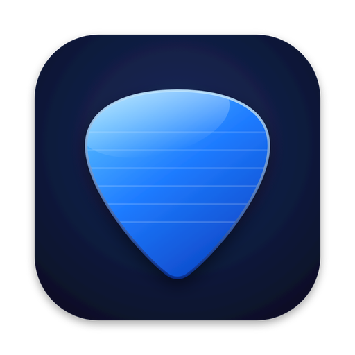

<div align="center">



# Fretline

### Learn any song, bar by bar, over the real recording.

A native guitar tab player for **iPad and Mac**. Open Guitar Pro files, follow the cursor over the original YouTube video, slow it down, loop the hard part and nail it.

[](#install)
[](#build-from-source)
[](#macos--homebrew-recommended)
[](https://github.com/rbc33/Fretline/releases/latest)

[**Install**](#install) · [**Features**](#features) · [**Build from source**](#build-from-source) · [**How it works**](#how-it-works)

</div>

---

## Why Fretline?

Tab sites are great at showing you the notes and bad at letting you **play along with the band**. Fretline puts the tab and the original recording side by side and keeps them locked together, so you learn the song the way it was actually played, not the way a MIDI file thinks it sounds.

- 🎸 **Your tabs, your device.** Everything lives offline in your library: no account, no subscription, no ads.
- 🎬 **The real track, in sync.** The tab cursor follows the YouTube video bar by bar, even through rubato and live takes.
- 🔁 **Practice the hard part.** Select one or more bars and loop them at 50% speed until they're second nature.
- ⚡ **Native and fast.** Built in SwiftUI for iPad and Mac, with a full SMuFL engraving and a real synth under the hood.

---

## Features

### 📂 Open anything
- **Guitar Pro**: `.gp`, `.gpx`, `.gp5`, `.gp4`, `.gp3`, plus **MusicXML**.
- Import from Files, AirDrop or **Open with… → Fretline** (on the Mac, the Finder too).
- **Search Songsterr from your library**: type in the search box to see your songs and Songsterr results side by side. One tap imports a tab.
- **Songsterr import**: paste a song link and Fretline fetches every track, converts it to Guitar Pro and brings the synced video along when one exists. *(Personal use, see [notes](#notes).)*

### 🎬 YouTube sync
- A floating video player, docked bottom-right by default; move it to any corner or shrink it.
- **Video as master clock**: play, pause, seek, loop and speed all drive the video, and the tab follows.
- **Tap-along sync editor**: tap (or hit Space, or a page-turner pedal mapped to Space) on beat 1 of each bar while the video plays. Repeats and alternate endings are handled for you.
- **Quick sync**: mark where bar 1 starts and Fretline fills in the rest from the tempo. Perfect for songs recorded to a click.
- Fine-tune with ±50 ms nudges and undo. Everything saves automatically.

### 🔁 Practice tools
- **Bar loops**: tap a start bar and an end bar (or drag across them) to loop just that section. Adjust each edge with −/+ or jump the whole loop to the next phrase with one tap.
- **Loops survive mode switches**: flip between synth and video and your selection stays put.
- **Speed control** from 25% to 150% (synth) or 25% to 200% (video).
- **Metronome** and **count-in**.

### 🎛️ Mixer and layout
- Show or hide tracks, plus **mute** and **solo** per track.
- **Page** or **horizontal** layout, with zoom in and out.
- The animated beat cursor auto-scrolls so you never lose your place.

### 🗂️ Library and history
- Searchable library with favourites.
- **Import history** grouped by day: reopen a song in one tap, or re-import a Songsterr tab you deleted.
- Recent Songsterr imports appear right in the import sheet.

### 🖥️ Mac-native
- **Space** to play or pause, even with the score focused; **⌘O** to import; **⌘Y** for history.
- Sandboxed, ad-hoc signed and installable with Homebrew.

---

## Install

### macOS · Homebrew (recommended)

```sh
brew install --cask rbc33/fretline/fretline
```

Update later with:

```sh
brew upgrade --cask fretline
```

### macOS · DMG

Grab the latest **`Fretline-x.y.z.dmg`** from [**Releases**](https://github.com/rbc33/Fretline/releases/latest), open it and drag **Fretline** to **Applications**.

> Fretline is ad-hoc signed (no Apple Developer ID yet). The first time, **right-click → Open**, or run
> `xattr -dr com.apple.quarantine /Applications/Fretline.app`. The Homebrew cask does this for you.

### iPad · SideStore / AltStore

1. Build the `.ipa` on your Mac:
   ```sh
   ./build-ipa.sh            # → Fretline.ipa (unsigned)
   ```
2. AirDrop `Fretline.ipa` to your iPad, or save it to iCloud Drive.
3. In **SideStore** or **AltStore**, go to **My Apps → ＋** and pick the `.ipa`. It gets signed with your Apple ID on install.

> With a free Apple ID, sideloaded apps expire after 7 days. SideStore refreshes them in the background as long as you open it now and then.

Prefer Xcode? Plug in the iPad, open the project, pick your Personal Team under *Signing & Capabilities* and press ▶.

---

## Build from source

**Requirements:** Xcode 15+, [XcodeGen](https://github.com/yonaskolb/XcodeGen), iPadOS 17 / macOS 14 SDKs.

```sh
git clone https://github.com/rbc33/Fretline.git
cd Fretline
brew install xcodegen
xcodegen                 # generates Fretline.xcodeproj from project.yml
open Fretline.xcodeproj
```

Choose the **Fretline** scheme for iPad or **FretlineMac** for macOS, then hit ▶.

### Build scripts

| Script | What it does |
| --- | --- |
| `./build-ipa.sh` | Unsigned `Fretline.ipa` for SideStore / AltStore |
| `./build-mac.sh` | `dist/Fretline.app` for macOS (ad-hoc signed) |
| `./build-dmg.sh` | `dist/Fretline-<version>.dmg` with an Applications shortcut, prints the SHA-256 |
| `./release.sh 0.2.0` | Bumps the version, builds the DMG, creates the GitHub release and updates the Homebrew cask in [`rbc33/homebrew-fretline`](https://github.com/rbc33/homebrew-fretline) |

`release.sh` needs the [GitHub CLI](https://cli.github.com) (`brew install gh && gh auth login`).

### Hacking on the engine

```sh
cd tools
npm install
npm test                 # Songsterr → Guitar Pro converter tests (Node)
npm run update-alphatab  # refresh the bundled alphaTab runtime
```

Both web views are inspectable: **Safari → Develop → [your device] → Fretline**.

---

## How it works

```
┌──────────────────────────── SwiftUI (iPad + Mac) ────────────────────────────┐
│  Library · History · Player · Sync editor · Bar loops · Mixer                │
│                                                                              │
│  TabEngine  ⇄  WKWebView  (fretline://app)                                   │
│                ├─ alphaTab: SMuFL rendering + SoundFont synth (offline)      │
│                └─ songsterr/convert.js → Guitar Pro 7                        │
│                                                                              │
│  YouTubePlayer ⇄ WKWebView (IFrame API)                                      │
│        video time ─────────▶ alphaTab external-media clock ─▶ tab cursor     │
│        play / seek / rate ◀─ alphaTab                                        │
└──────────────────────────────────────────────────────────────────────────────┘
```

- **One codebase, two platforms.** iPad and Mac share the same SwiftUI views; platform differences live in `Platform/Platform.swift` and a few `#if os(...)` blocks.
- **Rendering and audio** come from [alphaTab](https://alphatab.net), bundled locally and served through a custom `fretline://` scheme, so tabs and the synth work fully offline.
- **Sync points** are stored per song in SwiftData as alphaTab `FlatSyncPoint`s and interpolated by tempo between markers.
- **A playback watchdog** keeps the synth running through iOS audio interruptions until you press stop or the song ends.

```
Fretline/
├── Engine/        TabEngine (Swift ⇄ JS bridge), local scheme handler
├── YouTube/       IFrame player wrapper, video-ID parsing
├── Views/         Library, Player, SyncPanel, BarLoopPanel, History, sheets
├── Services/      Library storage, import history, Songsterr client
├── Models/        Song, ImportRecord (SwiftData)
├── Platform/      iPadOS / macOS shims
└── Web/           index.html, app.js, alphaTab runtime, SoundFont, converter
```

---

## Roadmap

- [ ] Built-in tuner (microphone)
- [ ] iCloud sync of library, loops and sync points
- [ ] Per-loop speed trainer (auto-increase tempo each pass)
- [ ] Apple Pencil annotations on the score
- [ ] Export and share sync maps

Ideas and PRs are welcome. Open an [issue](https://github.com/rbc33/Fretline/issues).

---

## Notes

- **Songsterr** has no public API. The importer uses the same endpoints as their web player, which may change without notice, and downloading their content may go against their Terms of Service. It's intended for **personal use only** and lives in two isolated files (`SongsterrClient.swift`, `Web/songsterr/convert.js`) so it's easy to remove.
- **YouTube**: some videos disable embedding (errors 101/150). Fretline tells you and lets you pick another.
- Fretline is an independent project and is **not affiliated** with Songsterr, Arobas Music (Guitar Pro) or YouTube.

## Credits

- [**alphaTab**](https://github.com/CoderLine/alphaTab) by Daniel Kuschny and contributors (MPL-2.0): music notation rendering and synthesis.
- [**Bravura**](https://github.com/steinbergmedia/bravura) SMuFL font by Steinberg (SIL OFL 1.1).
- **SONiVOX** General MIDI SoundFont, as distributed with alphaTab.

<div align="center">

---

Made by [**@rbc33**](https://github.com/rbc33).
If Fretline helped you finally nail that solo, **⭐ star the repo**. It really helps.

</div>
